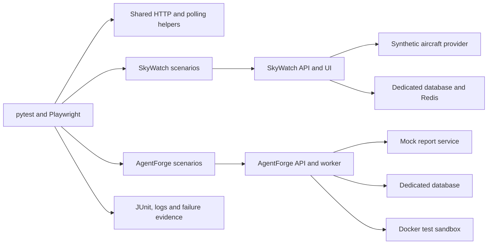

# TestForge

TestForge is a Python integration-testing project for two applications: [SkyWatch](https://github.com/owenliu11/skywatch), a real-time aircraft tracker, and [AgentForge](https://github.com/owenliu11/AgentForge), an agent that analyzes a repository and publishes a report. It runs the real applications with isolated synthetic dependencies, checks behavior through their interfaces, and saves evidence for investigation.



The targets have separate Compose projects, databases, and loopback ports. The provider data and credentials are synthetic. See [architecture and test strategy](docs/architecture.md) for boundaries, coverage, and limitations.

## Requirements

- macOS or Linux with Bash, Git, Python **3.12**, Docker Engine or Docker Desktop running, and Docker Compose v2.
- Internet access for Git repositories, Python packages, Docker images, browser installation, and frontend dependencies. Allow Docker enough memory and disk space to build both targets.
- Free loopback ports 18000, 18080, and 15173 for SkyWatch; 18010 and 18011 for AgentForge. AgentForge's worker needs access to the Docker socket to launch its disposable test sandbox. Use it only in a trusted test environment.
- Chromium installed through Playwright for the browser tests. On Linux, `playwright install --with-deps chromium` may require permission to install system packages.

## Fresh setup

Run these commands in an empty working directory; they create three separate checkouts. The target commits below are the versions exercised by CI.

```sh
git clone https://github.com/owenliu11/Testify.git testforge
git clone https://github.com/owenliu11/skywatch.git skywatch
git -C skywatch checkout --detach e83e675a66fa7cf8e00a1b28397be1f08a662832
git clone https://github.com/owenliu11/AgentForge.git agentforge
git -C agentforge checkout --detach 84b1c95aaa98c5855ab627aff141cdf12cac8da4
cd testforge
export SKYWATCH_DIR="$(cd ../skywatch && pwd -P)"
export AGENTFORGE_DIR="$(cd ../agentforge && pwd -P)"
python3.12 -m venv .venv
.venv/bin/python -m pip install .
.venv/bin/python -m playwright install chromium
docker pull python:3.12-alpine
```

Keep the target checkouts clean and at these revisions. AgentForge's runner enforces this; SkyWatch's runner uses the checkout supplied in `SKYWATCH_DIR`, so check its revision before running. Keep the two environment variables set in the terminal where you run the tests. No real OpenSky credentials or `.env` file are needed.

## Run the suites

```sh
# Core, API, all isolated SkyWatch scenarios, and the regression demonstration
bash scripts/run-phase-one.sh

# All AgentForge scenarios, including the worker-kill recovery test
bash scripts/run-agentforge-isolated.sh
```

Both commands return a nonzero status for a failure, empty suite, or unexpected skip. Each isolated scenario creates and tears down its own Compose project and test data. The regression demo temporarily introduces a known bug in a disposable SkyWatch clone, verifies the expected failure, restores it, and checks that the test passes. See [the demo guide](docs/demo.md) for a shorter presentation path.

To run one scenario while developing:

```sh
bash scripts/run-skywatch-isolated.sh tests/skywatch/integration/test_ingestion.py
bash scripts/run-agentforge-isolated.sh tests/agentforge/test_recovery.py
```

The isolated runners accept pytest paths or node IDs. For concurrent runs, assign distinct free ports using `TF_SKYWATCH_API_PORT`, `TF_SKYWATCH_FIXTURE_PORT`, `TF_SKYWATCH_UI_PORT`, `TF_API_PORT`, and `TF_EFFECTS_PORT`. For an installed Chrome on macOS, `TESTFORGE_BROWSER_CHANNEL=chrome` selects it instead of Playwright's Chromium.

## Results and CI

Local evidence lives under `reports/`, which Git ignores:

- `reports/skywatch/phase-one/`: Phase 1 JUnit results, isolated scenario logs, browser failure traces, and regression evidence.
- `reports/skywatch/isolated/`: evidence from separately invoked SkyWatch scenarios.
- `reports/agentforge/isolated/`: per-scenario JUnit, service logs, health and effects snapshots; the recovery test also records worker logs, events, and container exit state.

The [GitHub Actions workflow](.github/workflows/skywatch.yml) runs full SkyWatch and AgentForge suites in separate jobs and runs representative scenarios with both stacks running together. It uploads `skywatch-evidence`, `agentforge-evidence`, and `combined-evidence` artifacts, including on failure when available. Each job checks out the target at the pinned commit. If either target becomes private, CI needs the corresponding `SKYWATCH_READ_TOKEN` or `AGENTFORGE_READ_TOKEN` secret with repository read access.

## Limits and further reading

The fixtures make tests repeatable but do not prove behavior against live external providers, production load, or arbitrary applications. Direct TestForge Python dependencies and target source commits are pinned; Docker image tags, transitive dependencies, and external registries can change. Browser map tiles are replaced with a local fixture. AgentForge's sample repository intentionally contains a failing test; a completed agent run accurately reports that failure.

- [Architecture, strategy, and troubleshooting](docs/architecture.md)
- [Five-minute demo](docs/demo.md)
- [M2 risk traceability](docs/m2-risk-traceability.md), [M3 real-time traceability](docs/m3-realtime-traceability.md), [M4 regression evidence](docs/m4-regression-demo.md), and [M5 recovery](docs/m5-portability.md)
- [Baseline and release checklist](docs/baseline.md)

TestForge is available under the [MIT License](LICENSE). The target repositories are separate projects; consult their own license terms.
